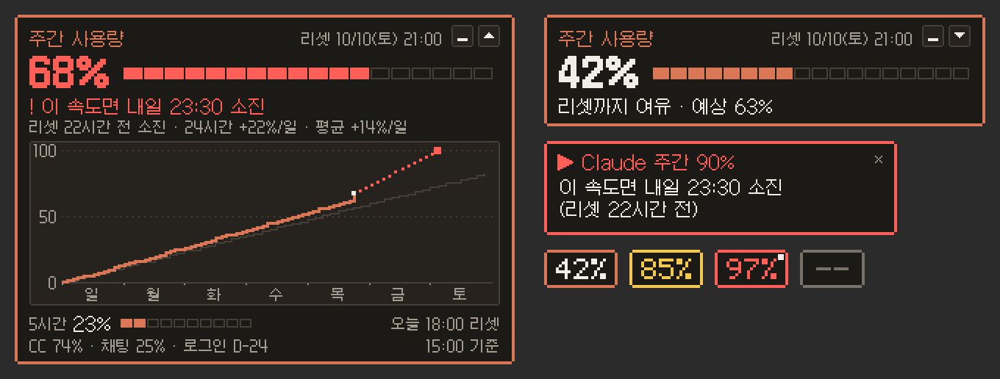

# Claude Usage Tray

이번 주 Claude를 얼마나 썼는지, **이 속도면 언제 다 쓰는지** 화면 구석에서 바로 보여주는 작은 위젯입니다.

> A tiny pixel-art Windows widget that shows your Claude plan's weekly usage and whether it will run out before the weekly reset. Korean UI.

> ⚠️ 비공식 도구입니다. Anthropic과 관련이 없고, Claude Code가 내부적으로 쓰는 비공개 API를 사용합니다. Anthropic이 API를 바꾸면 예고 없이 멈출 수 있습니다.

## 이런 걸 보여줘요

- **주간 사용량**과 리셋 시각
- **한 줄 판정:** "! 이 속도면 내일 18:10 소진" 또는 "리셋까지 여유 · 예상 88%"
- **이번 주 그래프:** 지난주와 비교하고, 앞으로의 예측선도 보여줍니다.
- **5시간 한도**, 그리고 Claude Code와 채팅에 쓴 비율
- **알림:** 80·90·95%에 도달했을 때, 리셋 전에 다 쓸 것 같을 때, 다시 로그인해야 할 때

Claude Code를 켜 두지 않아도 5분마다 저절로 갱신되고, claude.ai 웹에서 쓴 양도 포함됩니다.

## 설치

1. **준비:** [Claude Code](https://claude.com/claude-code)를 설치하고, `claude`를 실행해 claude.ai 계정(Pro/Max 등)으로 로그인해 두세요.
2. [Releases](../../releases/latest)에서 `ClaudeUsageTray.exe`를 받아 원하는 폴더에 두고 실행합니다.
   - "Windows의 PC 보호" 창이 뜨면 **추가 정보 → 실행**을 누르세요. 코드 서명이 없어서 뜨는 경고입니다.
3. 화면 오른쪽 아래에 위젯이 나타납니다. 다음부터는 Windows를 켤 때 자동으로 실행됩니다.

Windows 10/11 (64비트)에서 동작합니다.

## 쓰는 법

| 하고 싶은 것 | 방법 |
|---|---|
| 크게 보기 / 작게 보기 | 위젯을 **더블클릭**하거나, 위젯 위에서 **마우스 휠**을 굴리세요 |
| 아주 작은 아이콘으로 줄이기 | `–` 버튼을 누르세요 (아이콘을 클릭하면 다시 펼쳐집니다) |
| 옮기기 | 끌어서 옮기세요. 화면 가장자리에 가까이 가면 딱 붙습니다 |
| 메뉴 (새로고침, 크기, 위치 초기화, 종료 등) | 위젯을 **오른쪽 클릭**하세요 |

크기와 위치는 기억해 두었다가 다음에도 그대로 보여줍니다. 위젯은 지금 쓰고 있는 창을 방해하지 않습니다. 클릭해도 키보드 입력을 가로채지 않고, 소리도 없고, 게임이나 영상을 전체 화면으로 보는 동안에는 숨어 있습니다.

### 테두리 색의 뜻

| 색 | 의미 |
|---|---|
| 🟧 주황 | 정상 |
| 🟨 노랑 | 80% 이상이거나, 리셋까지 아슬아슬함 |
| 🟥 빨강 | 95% 이상이거나, 이 속도면 리셋 전에 다 씀 |
| ⬜ 회색 | 15분 이상 새 정보를 못 받음 (인터넷이나 로그인 확인) |

## 자주 묻는 질문

**"! 로그인 필요"가 떠요.**
줄에 있는 **[로그인]** 버튼을 누르면 로그인 창이 열립니다. 브라우저에서 로그인한 뒤 나오는 코드를 창에 붙여넣으세요. Claude Code 로그인은 약 4주마다 만료되고, 위젯이 3일 전부터 알려줍니다.

**제 Claude 사용량을 더 쓰나요?**
거의 쓰지 않습니다. 로그인 정보가 만료되면 갱신하려고 Claude에 아주 짧은 요청(약 580토큰)을 보내는데, 하루 2~3번 정도입니다.

**제 정보는 안전한가요?**
로그인 정보는 Anthropic 서버(`api.anthropic.com`)에만 보내고, 어디에도 저장하거나 기록하지 않습니다. 다른 곳으로 보내는 데이터도 없습니다. 자세한 내용은 [고급 정보](docs/ADVANCED.md#보안과-개인정보)에 있습니다.

**받은 파일이 진짜인지 확인하고 싶어요.**
릴리스에 함께 있는 `ClaudeUsageTray.exe.sha256`의 값과 PowerShell에서 `(Get-FileHash .\ClaudeUsageTray.exe).Hash` 결과가 같으면 원본입니다.

**알림 기준이나 갱신 간격을 바꾸고 싶어요.**
위젯 오른쪽 클릭 → **설정 파일 열기**로 바꿀 수 있습니다. 항목 설명은 [고급 정보](docs/ADVANCED.md#설정-파일)에 있습니다.

## 삭제

1. 위젯 오른쪽 클릭 → **Windows 시작 시 실행** 체크를 끕니다.
2. 위젯 오른쪽 클릭 → **종료**를 누릅니다.
3. `ClaudeUsageTray.exe`와 `%APPDATA%\ClaudeUsageTray` 폴더를 지웁니다.

## 더 보기

- [고급 정보](docs/ADVANCED.md): 설정 파일, 동작 원리, 보안, 자원 사용량, 소스에서 빌드하기
- [설계 문서](docs/SPEC.md)
- [변경 기록](CHANGELOG.md)

## 라이선스

- 코드: [MIT](LICENSE)
- 폰트: [Galmuri](https://github.com/quiple/galmuri) © Lee Minseo, SIL Open Font License 1.1 ([assets/Galmuri-OFL.txt](assets/Galmuri-OFL.txt)). 앱에 필요한 글자만 남긴 부분 집합을 포함합니다.

Claude는 Anthropic의 상표입니다. 이 프로젝트는 Anthropic과 관련이 없습니다.
